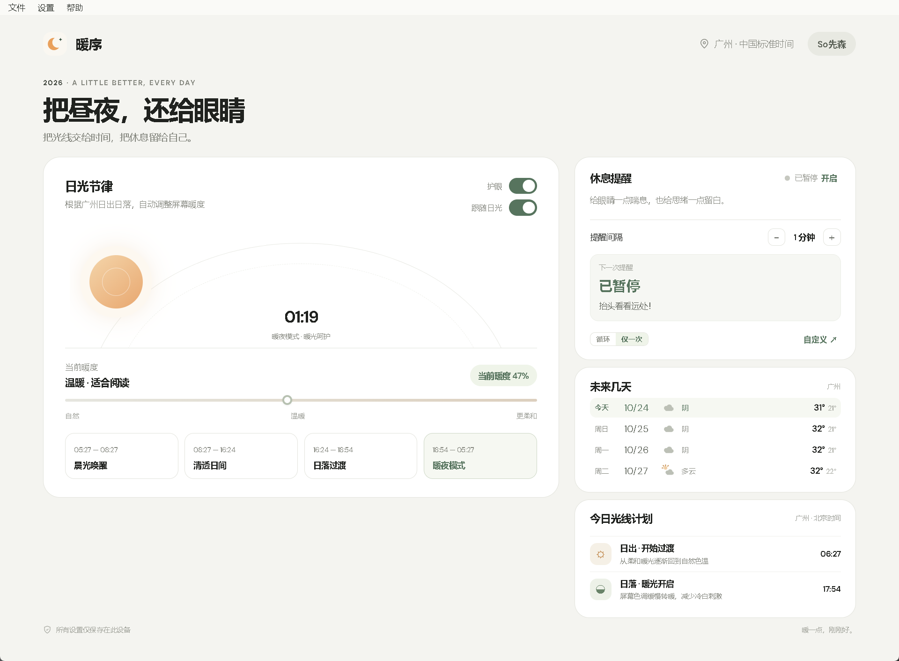

# 暖序 · NuanXu

> 把昼夜，还给眼睛
> 软件适用需求：想要护眼软件、屏幕太亮 / 屏幕刺眼、夜间模式调节、防蓝光

按你所在城市的真实日出日落，自动把 Windows 屏幕色温从清晨的冷调过渡到深夜的暖调。
常驻托盘，直接写显卡伽马表，零延迟、不占资源。

**完全免费 · 无广告 · 无内购 · 无需登录 · 不上传任何数据**
官方网址：https://www.nuanxu.asia



## 下载

到 [**Releases**](https://github.com/Garlic7288/nuanxu/releases/latest) 页面下载最新版，两个文件任选其一：

| 文件 | 说明 | 大小 |
| --- | --- | --- |
| `nuanxu-x.y.z-setup.exe` | 安装版。双击运行，向导里可以选「仅为我安装」（不需要管理员权限）或「为所有用户安装」 | 约 49 MB |
| `nuanxu-x.y.z-portable.zip` | 绿色版。解压后直接运行 `暖序.exe`，不写注册表 | 约 62 MB |

> 大陆网络访问 GitHub 可能较慢。如果下载反复中断，可以稍后重试，或改用镜像地址（待补充）。

### 关于安全提示

本项目**没有购买代码签名证书**，首次运行时 Windows SmartScreen 会提示「已保护你的电脑」。
点「更多信息」→「仍要运行」即可。

部分安全软件也可能对修改屏幕色彩表的程序报警，属于未签名程序的常见误报。
源码完全公开，可以自行编译核对，也可以直接看 [THIRD-PARTY-NOTICES.md](THIRD-PARTY-NOTICES.md)。

## 它做什么

- **跟随日光调色温**：按当前城市的日出日落计算曲线，清晨由冷转暖、白天保持通透、日落后逐渐加深，夜里最柔和。全中国统一北京时间，但日出日落按真实经纬度算（乌鲁木齐和上海能差 4 小时）。
- **固定暖度**：不想跟着太阳走就关掉「跟随日光」，用滑块自己定一个固定暖度。
- **休息提醒**（默认关闭，需要自己开）：按设定间隔弹一次提醒，支持「循环 / 仅一次」「5 分钟后」「今天跳过」。全屏演讲或投屏时会自动顺延，不会打断。
- **多显示器**：自动识别所有屏幕，中途插拔也能正确还原。
- **全局快捷键**，前台是 Excel / PPT / 浏览器时同样生效：

  | 快捷键 | 作用 |
  | --- | --- |
  | `Ctrl+Alt+E` | 护眼总开关。投屏、全屏演讲前按一下还原原色，讲完再按一下恢复 |
  | `Ctrl+Alt+F` | 切换「跟随日光」 |
  | `Ctrl+Alt+P` | 暂停 30 分钟；暂停中再按一次立即恢复 |

- **开机自动启动**（默认关闭）：开机后静默驻留托盘，不弹窗口。
- **本地天气**：未来几天的天气与温度，数据来自 Open-Meteo，只发送城市经纬度。

## 系统要求

- Windows 10 1809（build 17763）及以上，**仅 64 位**
- Microsoft Edge WebView2 运行时。绝大多数 Windows 10/11 已经自带；安装程序检测到缺失会自动联网安装（约 150MB），装不上也会提示手动下载地址。

## 使用

1. 安装后启动，程序常驻系统托盘，关闭窗口即最小化到托盘
2. 主界面拖动滑块调节暖度；开启「跟随日光」后由日照曲线自动决定，滑块会锁定
3. 右键托盘图标可快速切换护眼开关、暂停、打开主界面
4. 「设置」菜单里可以选择所在地区，时间轴与天气会跟着变

## 数据与隐私

- 设置保存在 `%LOCALAPPDATA%\Nuánxù\settings.json`，**只在本机**，不上传。
- 唯一的联网请求是向 [Open-Meteo](https://open-meteo.com/) 取当天和未来三天的天气，参数只有当前城市的经纬度，不带账号、不带设备标识、不带任何个人数据。断网时天气卡片留空，其余功能不受影响。
  （任何网络请求都会让对端看到你的公网 IP，这是 HTTP 协议的固有属性。）
- 没有埋点、没有遥测、没有崩溃上报、没有自动更新。
- 卸载会清掉程序目录、WebView2 缓存和色温快照，**保留 `settings.json`**（重装后设置还在）。

## 已知限制

- **HDR 模式**下 Windows 不允许修改伽马表，调色会失效并给出提示，需要关闭 HDR。
- 部分笔记本/显卡驱动会拒绝写入伽马表；虚拟显示器、远程桌面、部分投屏器同样受限。
- 混合 DPI 多显示器（例如笔记本 150% + 外接屏 100%）时，副屏界面可能略有发虚。
- 界面展示的暖度是调节强度，不是仪器测量的蓝光过滤百分比。
- 同时开着 f.lux 或 Windows 夜间模式时，两者会抢写同一张显卡色彩表，画面可能来回跳，建议只留一个。

## 遇到问题

菜单「帮助 → 诊断信息…」会生成 `diag.txt`（显示器自检）并打开数据目录，连同同目录下的 `app.log` 一起发到 [Issues](https://github.com/Garlic7288/nuanxu/issues) 会快很多。

两个文件都在 `%LOCALAPPDATA%\Nuánxù\`。`app.log` 每次启动会记一行环境信息（版本、构建时间、系统版本、屏幕缩放、显示器数量），出问题时先看这一行就能确认装的是哪一版。

### 命令行参数

平时双击运行即可，下面几个参数只在排障或自动化时用得上：

| 参数 | 作用 |
| --- | --- |
| `--diag` | 不开界面，直接跑一遍显示器自检（枚举 → 写暖色 → 回读比对 → 还原），结果写进 `diag.txt` |
| `--autostart` | 静默进托盘、不弹窗口。开机自启的注册表值带这个参数，一般不用手敲 |
| `--quit` | 请正在运行的实例优雅退出（会先还原屏幕色彩）。安装器、卸载器都走这条 |

## 开发与构建

需要 .NET 8 SDK；打包还需要 [Inno Setup 6.5+](https://jrsoftware.org/isinfo.php)。

```powershell
.\build-windows.ps1      # 只出 dist
.\build-installer.ps1    # 出安装包与绿色版到 release\
```

> **打安装包必须走 `build-installer.ps1`**。`installer/redist/` 里的 WebView2 引导器不入库，
> 脚本会自动下载；直接调用 ISCC 编译 `暖序.iss` 会报 `Source file does not exist`。

技术细节见 [WINDOWS-APP.md](WINDOWS-APP.md)。

## 赞赏

如果这个软件对你有帮助，可以请我喝杯咖啡。完全自愿，不影响任何功能，也不会有任何区别对待。


## 许可证

[MIT License](LICENSE)。你可以自由使用、修改、分发，包括商用；只需保留版权声明。

第三方组件的版权与许可见 [THIRD-PARTY-NOTICES.md](THIRD-PARTY-NOTICES.md)。

---

**English** — NuanXu is a free Windows color-temperature tool that follows the real
sunrise and sunset at your location. No ads, no account, no telemetry. Windows 10/11 x64 only.
Download from the [Releases](https://github.com/Garlic7288/nuanxu/releases/latest) page.
Licensed under MIT.
